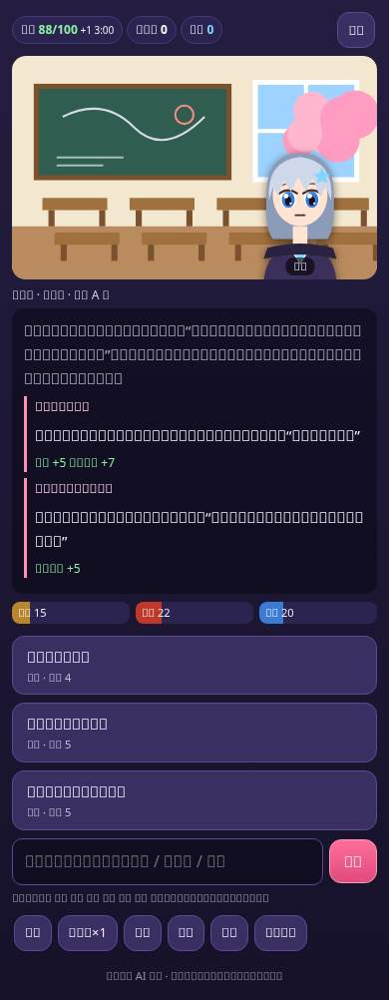

# 我成了动漫主角

小红书小工具小游戏，AI 互动故事玩法。你扮演异世界学园的主角，可以点选项，也可以自己打字写行动，剧情跟着你走。本游戏由 AI 制作。

- 直接打开 `index.html` 就能玩，零网络请求。
- 5 章主线 + 1 章番外，16 个场景，5 个结局，8 类意图。
- 自测：`node tests/selftest.js`（Node 18+，无依赖）。
- 架构、经济闭环和自测结果见 [docs/CHANGES.md](docs/CHANGES.md)，spec 在 `.kiro/specs/anime-hero/`。

